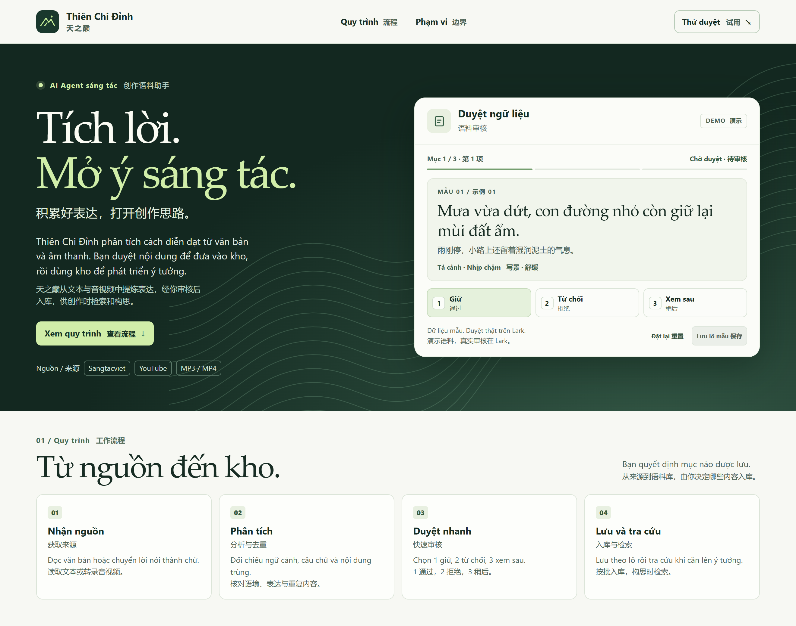

# Thiên Chi Đỉnh · 天之巅

**Thiên Chi Đỉnh** là AI Agent giúp xây kho ngữ liệu cho sáng tác. Agent đọc văn bản hoặc chuyển lời nói thành chữ, phân tích cách diễn đạt và trình từng mục để người dùng duyệt. Kho đã duyệt hỗ trợ tra cứu và phát triển ý tưởng.

**天之巅**是一款面向创作的语料助手。它读取文本或转录音视频，提炼表达并逐条提交人工审核。审核通过的语料可用于检索与构思。

[**Mở demo · 打开演示**](https://tian-zhi-dian-language-agent.frosty-comet-2056.chatgpt.site/)

## Quy trình · 工作流程

1. **Nhận nguồn · 接收来源** — Văn bản, liên kết Sangtacviet hoặc YouTube, tệp MP3/MP4.
2. **Phân tích · 分析** — Kiểm tra bản chép lời, ngữ cảnh, cấu trúc câu, sắc thái và nội dung nghi trùng.
3. **Duyệt · 审核** — `1` Giữ / 通过 · `2` Từ chối / 拒绝 · `3` Xem sau / 稍后.
4. **Lưu và tra cứu · 入库与检索** — Lưu theo lô các mục đã duyệt, tra cứu khi lên ý tưởng.

## Tài liệu · 项目资料

| Tệp · 文件 | Nội dung · 内容 |
| --- | --- |
| [Thẻ công việc · 岗位卡](docs/01-岗位卡.md) | Đầu vào, đầu ra, tiêu chí và phạm vi · 输入、输出、标准与边界 |
| [Thẻ quy trình · 工作流卡片](docs/02-工作流卡片.md) | Các bước, điểm quyết định và xử lý ngoại lệ · 步骤、判断点与异常处理 |
| [Sơ đồ Mermaid · 流程图](docs/03-流程图.md) · [Ảnh PNG · 图片](docs/workflow.png) | Quy trình thu thập, duyệt và tra cứu · 采集、审核与检索 |
| [Lược đồ dữ liệu · 数据结构](docs/corpus-record.schema.json) | Cấu trúc bản ghi ngữ liệu · 语料条目结构 |
| [Mã nguồn demo · 演示源码](showcase/) | HTML, CSS và JavaScript |

## Chạy thử · 本地体验

Tải hoặc clone repo, rồi mở [`showcase/index.html`](showcase/index.html) bằng trình duyệt. Chọn một quyết định cho mỗi mẫu, rồi bấm **Lưu lô mẫu** để xem kết quả. Dữ liệu minh họa tồn tại trong phiên mở trang. Phiên bản vận hành thực tế dùng Hermes và Lark để xử lý và duyệt ngữ liệu.

下载或克隆仓库，用浏览器打开 `showcase/index.html`。逐条选择审核结果，再点击 **保存** 查看汇总。演示数据仅在当前页面会话中保留。实际工作流在 Hermes 与 Lark 中运行。
