# 03-流程图 / Sơ đồ quy trình

本图对应 **语料管家 / Quản gia ngữ liệu**，用于检查从语料采集、审核、批量入库到创作辅助的完整执行路径与人工兜底点。

Sơ đồ này dành cho **Quản gia ngữ liệu / 语料管家**, dùng để kiểm tra toàn bộ đường đi từ thu thập, duyệt, ghi theo lô đến hỗ trợ sáng tác và các điểm cần người dùng can thiệp.

```mermaid
flowchart TD
    startNode([Nhận nhiệm vụ / 接收任务])
    modeCheck{Loại nhiệm vụ? / 任务类型?}

    startNode --> modeCheck

    subgraph ingestFlow ["Xây dựng kho ngôn ngữ / 构建语料库"]
        validateInput[Kiểm tra nhãn và định dạng / 验证标签与格式]
        sourceMatch{Nguồn khớp nhãn? / 来源匹配?}
        humanSource[Người dùng xác nhận nguồn / 人工确认来源]
        sangtacvietSource{Nguồn Sangtacviet? / Sangtacviet 来源?}
        browserReady{Hermes có browser đọc JavaScript? / Hermes 浏览器可用?}
        humanBrowserSetup[Dừng và báo cần cấu hình browser / 暂停并交接浏览器配置]
        loadRendered[Quan sát trang, đóng hộp thoại, nhấn đúng vùng tải / 观察页面、关闭弹窗并点击加载区]
        renderedReady{Có văn bản chương đọc được? / 正文可读?}
        sourceScope[Ghi phạm vi và phương thức browser_rendered / 记录范围与读取方式]
        accessCheck{Truy cập được? / 可访问?}
        humanLink[Yêu cầu đường dẫn khác / 请求替代链接]
        metadataProcess[Bổ sung metadata từ nguồn chính thức / 从官方来源补充元数据]
        metadataReady{Thông tin đủ rõ? / 信息明确?}
        humanMeta[Người dùng bổ sung thông tin / 人工补充信息]
        saveRaw[Lưu bản gốc bất biến / 保存不可变原始数据]
        extractText[Trích xuất hoặc chuyển lời / 提取或转写]
        homophoneCheck{Lỗi đồng âm xử lý được? / 同音错误可解决?}
        criticalMeaning{Ảnh hưởng ý chính? / 影响核心含义?}
        markUnknown[Đánh dấu chưa rõ và bỏ qua / 标记未知并跳过]
        humanMeaning[Người dùng xác nhận ý nghĩa / 人工确认含义]
        stagingAnalyze[Làm sạch kỹ thuật và phân tích / 技术清理与分析]
        structureStore[Phân loại, mô hình câu và author_id / 分类、句式与作者编码]
        duplicateCheck{Gần như trùng nguyên văn? / 几乎完全重复?}
        humanDuplicate[Người dùng quyết định giữ hay bỏ / 人工决定保留或跳过]
        keepNew{Giữ bản mới? / 保留新版本?}
        skipDuplicate[Đánh dấu bỏ qua / 标记跳过]
        reviewItem[Hiển thị từng mục cần duyệt / 逐项展示审核内容]
        reviewCode{Mã duyệt 1, 2 hay 3? / 审核码?}
        approveState[Đánh dấu approved / 标记已批准]
        rejectState[Đánh dấu rejected / 标记已拒绝]
        pendingState[Đánh dấu pending / 标记待审核]
        reviewJournal[Ghi nhật ký tạm ngay / 立即写入临时审核日志]
        moreReview{Còn mục cần duyệt? / 还有待审核项?}
        pendingOverdue{Pending quá ba ngày? / 待审核超过三天?}
        quarantineState[Chuyển quarantine và giữ lại / 转入隔离并保留]
        batchCommit[Ghi và cập nhật theo lô / 批量提交与更新]
        officialStore[Lưu approved và cập nhật chỉ mục / 保存已批准并更新索引]
        removeDerived[Xóa dữ liệu dẫn xuất rejected / 删除拒绝项衍生数据]
        isolatedStore[Giữ pending ngoài chỉ mục / 待审核数据不入索引]
        commitCheck{Ghi lô thành công? / 批量提交成功?}
        recoverJournal[Khôi phục từ nhật ký tạm / 从临时日志恢复]
        ingestDone([Hoàn tất lô / 批次完成])

        validateInput --> sourceMatch
        sourceMatch -->|"Có / 是"| sangtacvietSource
        sourceMatch -->|"Không / 否"| humanSource
        humanSource --> validateInput

        sangtacvietSource -->|"Có / 是"| browserReady
        sangtacvietSource -->|"Không / 否"| accessCheck
        browserReady -->|"Có / 是"| loadRendered
        browserReady -->|"Không / 否"| humanBrowserSetup
        humanBrowserSetup --> browserReady
        loadRendered --> renderedReady
        renderedReady -->|"Có / 是"| sourceScope
        renderedReady -->|"Không / 否"| humanLink
        sourceScope --> metadataProcess

        accessCheck -->|"Có / 是"| metadataProcess
        accessCheck -->|"Không / 否"| humanLink
        humanLink --> validateInput

        metadataProcess --> metadataReady
        metadataReady -->|"Có / 是"| saveRaw
        metadataReady -->|"Không / 否"| humanMeta
        humanMeta --> saveRaw

        saveRaw --> extractText
        extractText --> homophoneCheck
        homophoneCheck -->|"Có / 是"| stagingAnalyze
        homophoneCheck -->|"Không / 否"| criticalMeaning
        criticalMeaning -->|"Không / 否"| markUnknown
        criticalMeaning -->|"Có / 是"| humanMeaning
        markUnknown --> stagingAnalyze
        humanMeaning --> stagingAnalyze

        stagingAnalyze --> structureStore
        structureStore --> duplicateCheck
        duplicateCheck -->|"Không / 否"| reviewItem
        duplicateCheck -->|"Có / 是"| humanDuplicate
        humanDuplicate --> keepNew
        keepNew -->|"Có / 是"| reviewItem
        keepNew -->|"Không / 否"| skipDuplicate
        skipDuplicate --> reviewJournal

        reviewItem --> reviewCode
        reviewCode -->|"1 Đồng ý / 批准"| approveState
        reviewCode -->|"2 Từ chối / 拒绝"| rejectState
        reviewCode -->|"3 Xem sau / 待审核"| pendingState

        approveState --> reviewJournal
        rejectState --> reviewJournal
        pendingState --> reviewJournal

        pendingState -.-> pendingOverdue
        pendingOverdue -->|"Có / 是"| quarantineState
        pendingOverdue -->|"Không / 否"| isolatedStore

        reviewJournal --> moreReview
        moreReview -->|"Có / 是"| reviewItem
        moreReview -->|"Không / 否"| batchCommit

        batchCommit --> officialStore
        batchCommit --> removeDerived
        batchCommit --> isolatedStore
        officialStore --> commitCheck
        removeDerived --> commitCheck
        isolatedStore --> commitCheck

        commitCheck -->|"Có / 是"| ingestDone
        commitCheck -->|"Không / 否"| recoverJournal
        recoverJournal --> batchCommit
    end

    subgraph creativeFlow ["Hỗ trợ sáng tác / 创作辅助"]
        creativeInput[Phân tích bối cảnh và ý tưởng / 分析背景与构思]
        retrieveCorpus[Truy xuất kho nội bộ / 检索内部语料库]
        enoughCorpus{Ngữ liệu phù hợp? / 语料合适?}
        humanBroaden[Đề nghị mở rộng tiêu chí / 请求扩大检索范围]
        ideaGroups[Tạo 3 đến 4 nhóm không xếp hạng / 生成三至四组无排名构思]
        humanIdea[Người dùng chọn ý tưởng / 人工选择构思]
        proposeStyle[Đề xuất một cách hành văn / 提议一种行文方式]
        styleCode{Mã lựa chọn 1, 2 hay 3? / 选择码?}
        buildPlot[Xây dựng cốt truyện / 构建剧情]
        pauseCreative[Tạm dừng để xem sau / 暂停待定]
        humanFinal[Người dùng duyệt kết quả cuối / 人工审核最终结果]
        creativeDone([Hoàn tất hỗ trợ / 辅助完成])

        creativeInput --> retrieveCorpus
        retrieveCorpus --> enoughCorpus
        enoughCorpus -->|"Có / 是"| ideaGroups
        enoughCorpus -->|"Không / 否"| humanBroaden
        humanBroaden --> retrieveCorpus

        ideaGroups --> humanIdea
        humanIdea --> proposeStyle
        proposeStyle --> styleCode
        styleCode -->|"1 Đồng ý / 接受"| buildPlot
        styleCode -->|"2 Tiếp theo / 下一个"| proposeStyle
        styleCode -->|"3 Xem sau / 待定"| pauseCreative
        pauseCreative -.-> proposeStyle

        buildPlot --> humanFinal
        humanFinal --> creativeDone
    end

    modeCheck -->|"Thu thập / 采集"| validateInput
    modeCheck -->|"Sáng tác / 创作"| creativeInput

    classDef human fill:#FFE0C2,stroke:#FF9E42
    classDef pending fill:#FFECBD,stroke:#FFC943
    classDef success fill:#CDF4D3,stroke:#66D575
    classDef warning fill:#FFCDC2,stroke:#FF7556

    class humanSource,humanBrowserSetup,humanLink,humanMeta,humanMeaning,humanDuplicate,reviewCode,humanBroaden,humanIdea,styleCode,humanFinal human
    class pendingState,quarantineState,isolatedStore,pauseCreative pending
    class approveState,officialStore,ingestDone,creativeDone success
    class rejectState,removeDerived,recoverJournal warning
```

Sangtacviet theo nhánh trình duyệt ở J01a của `02-工作流卡片.md`. Đoạn trích vẫn có thể được xử lý khi ghi rõ phạm vi; chưa có browser Hermes thì dừng ở bước cấu hình. Kết quả thử trong Codex không tự làm nhánh Hermes trở thành đã kiểm chứng.

Sangtacviet 遵循工作流卡片 J01a 的浏览器分支。片段可在标明范围后处理；Hermes 浏览器尚未可用时停在配置交接点。Codex 测试通过不代表 Hermes 分支已经验证。
